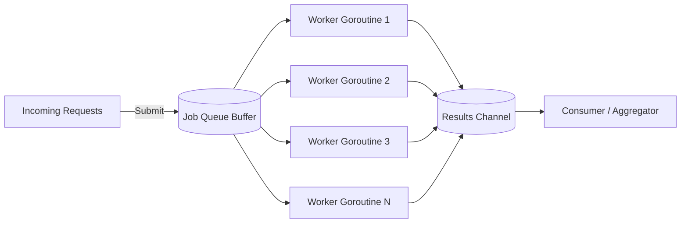
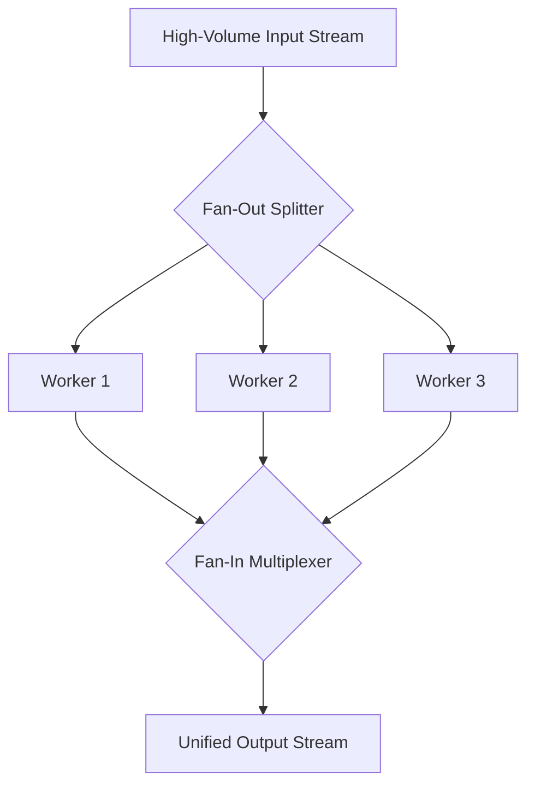
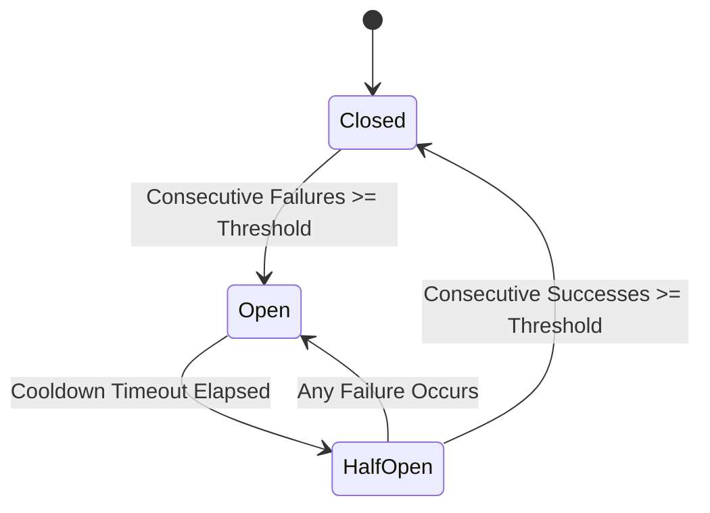
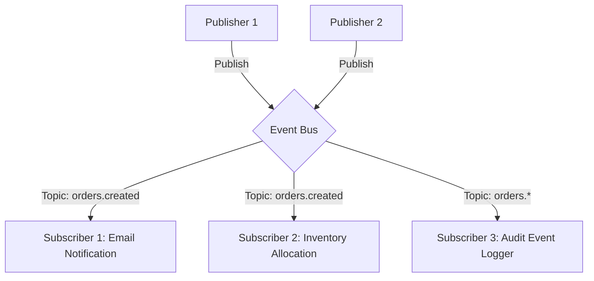
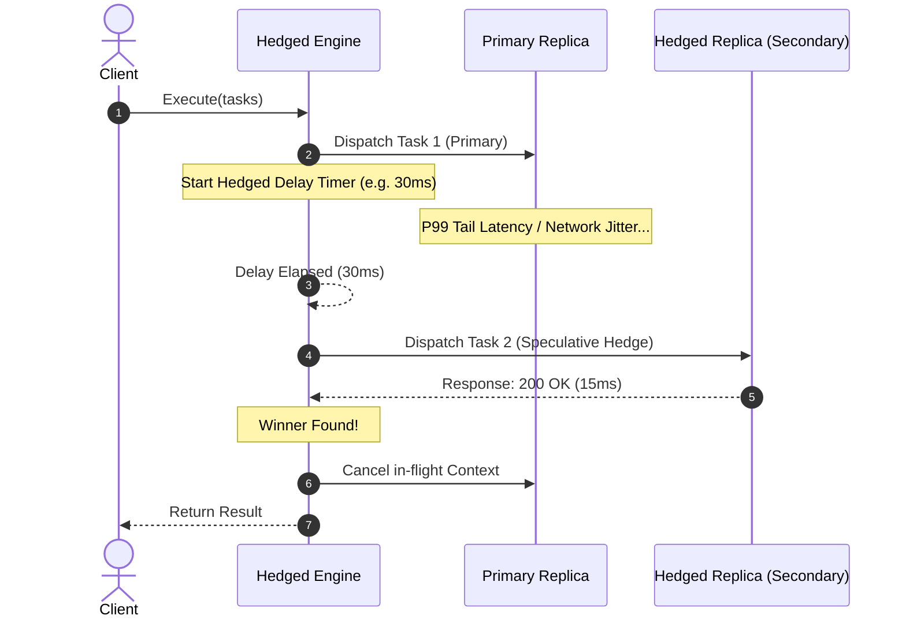
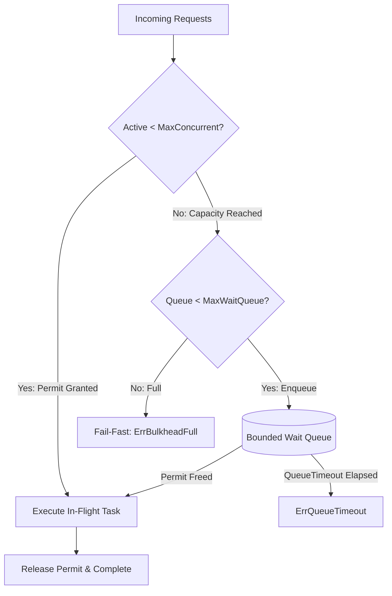
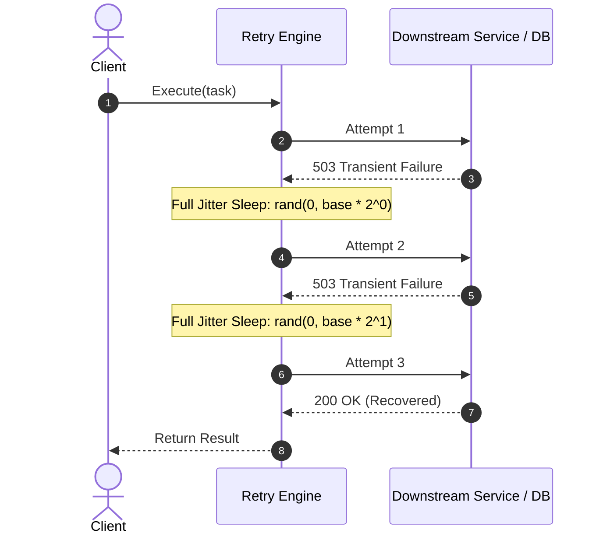

# Go Concurrency & Design Patterns in Action

[](https://golang.org)
[](https://github.com/davhernandezgo/go-concurrency-patterns/actions)
[](https://opensource.org/licenses/MIT)
[](https://github.com/davhernandezgo/go-concurrency-patterns)

> A production-ready, benchmarked suite of **Idiomatic Design Patterns** and **Advanced Concurrency Primitives** in Go. Designed for high-throughput microservices, distributed pipelines, and resilient backend systems.

---

## 📑 Table of Contents

- [Overview](#-overview)
- [Architecture & Concurrency Visualizations](#-architecture--concurrency-visualizations)
  - [1. Worker Pool with Backpressure](#1-worker-pool-with-backpressure)
  - [2. Multi-Stage Pipeline](#2-multi-stage-pipeline)
  - [3. Fan-Out / Fan-In](#3-fan-out--fan-in)
  - [4. Resilient Circuit Breaker](#4-resilient-circuit-breaker)
  - [5. Concurrent Event Bus (Pub/Sub)](#5-concurrent-event-bus-pubsub)
  - [6. Hedged Requests (Tail-Tolerance)](#6-hedged-requests-tail-tolerance)
  - [7. Bulkhead Resource Isolation](#7-bulkhead-resource-isolation)
  - [8. Resilient Exponential Backoff & Jitter](#8-resilient-exponential-backoff--jitter)
- [Catalog of Patterns](#-catalog-of-patterns)
  - [Concurrency Primitives](#concurrency-primitives)
  - [Idiomatic & GoF Design Patterns](#idiomatic--gof-design-patterns)
- [Performance & Benchmarks](#-performance--benchmarks)
- [Getting Started](#-getting-started)
- [Author & Contact](#-author--contact)

---

## 🎯 Overview

In Go, applying classic Object-Oriented patterns blindly often leads to unidiomatic and inefficient code. True Go mastery lies in combining **CSP (Communicating Sequential Processes)** concurrency models with **Go-idiomatic software composition** (interfaces, functional options, middleware decorators, and channel topologies).

This repository serves as a **battle-tested reference** showcasing:
1. **Zero-leak concurrency**: Context cancellation, bounded channel buffers, and guaranteed goroutine lifecycle control.
2. **Backpressure management**: Non-blocking `TrySubmit` and bounded worker queues to prevent out-of-memory cascades under burst traffic.
3. **Resilience engineering**: Circuit Breaker with automatic half-open health checks and Token-Bucket Rate Limiting.
4. **Clean Code & Idiomatic Patterns**: Functional Options, Onion-style HTTP Middleware Chains, and Dynamic Strategy swapping.

---

## 📐 Architecture & Concurrency Visualizations

### 1. Worker Pool with Backpressure


### 2. Multi-Stage Pipeline


### 3. Fan-Out / Fan-In


### 4. Resilient Circuit Breaker


### 5. Concurrent Event Bus (Pub/Sub)


### 6. Hedged Requests (Tail-Tolerance)


### 7. Bulkhead Resource Isolation


### 8. Resilient Exponential Backoff & Jitter


---

## 📦 Catalog of Patterns

### Concurrency Primitives

| Pattern | Description | Key Features |
| :--- | :--- | :--- |
| **Worker Pool** (`pkg/concurrency/workerpool`) | Manages fixed workers consuming from a synchronized queue. | Dynamic types via Go Generics, graceful shutdown via `Stop()` and `StopNow()`, non-blocking `TrySubmit()`. |
| **Pipeline** (`pkg/concurrency/pipeline`) | Composable data transformations connected via channels. | `Generator`, `Map`, `Filter`, `Batch` with time-window fallback, and `Reduce`. |
| **Fan-Out / Fan-In** (`pkg/concurrency/fanout`) | Distributes workloads across goroutines and multiplexes results. | Parallel CPU/IO multiplexing with `sync.WaitGroup` and leak-free cancellation. |
| **Circuit Breaker** (`pkg/concurrency/circuitbreaker`) | Prevents cascading system failures during downstream outages. | Three-state machine (`CLOSED`, `OPEN`, `HALF_OPEN`), thread-safe state transitions, zero external dependencies. |
| **Token Bucket Limiter** (`pkg/concurrency/ratelimiter`) | Throttles traffic allowing bursts up to bucket capacity. | Float precision refill calculation, instant `Allow()`, and non-busy-waiting `Wait(ctx)`. |
| **Singleflight** (`pkg/concurrency/singleflight`) | Suppresses duplicate in-flight requests (cache stampede prevention). | Executes identical concurrent requests only once, broadcasting results across all waiting callers. Supports blocking `Do()` and non-blocking `DoChan()` for timeout/context select loops. |
| **Event Bus (Pub/Sub)** (`pkg/concurrency/pubsub`) | High-performance in-memory 1-to-N publish/subscribe broker. | Generic types, hierarchical/wildcard topic matching (`*`, `prefix.*`), configurable backpressure (`Block`, `DropOldest`, `DropNewest`), and leak-free graceful shutdown. |
| **Hedged Requests** (`pkg/concurrency/hedged`) | Eliminates high-percentile (P99/P99.9) tail latency via speculative execution. | Configurable hedging delay, capped concurrency (`WithMaxHedges`), instant failover on early errors, context cancellation for losers, and atomic telemetry metrics. |
| **Bulkhead** (`pkg/concurrency/bulkhead`) | Isolates downstream dependency resources and throttles execution. | Bounded concurrency limit, queue capacity buffering, strict queue wait timeout, fail-fast `TryExecute()`, zero allocations on fast-path. |
| **Retry & Jitter** (`pkg/concurrency/retry`) | Resilient transient failure recovery with backoff and anti-collision jitter. | Exponential growth, configurable jitter strategies (`FullJitter`, `EqualJitter`, `NoJitter`), error classification predicates (`WithRetryIf`), and non-leaking context timers. |

### Idiomatic & GoF Design Patterns

| Pattern | Package | Real-World Application |
| :--- | :--- | :--- |
| **Functional Options** | `pkg/patterns/functionaloptions` | Flexible, backward-compatible constructor for servers, HTTP clients, and database connection pools without constructor telescoping. |
| **Middleware / Decorator** | `pkg/patterns/middleware` | Onion-style HTTP request decorators for Distributed Tracing (Correlation ID), Request Timing, and Panic Recovery. |
| **Strategy** | `pkg/patterns/strategy` | Polymorphic payment engines (Credit Card, Crypto, ACH) hot-swappable at runtime. |
| **Thread-Safe Singleton** | `pkg/patterns/singleton` | Safe single-instance initialization using `sync.Once`. |

---

## ⚡ Performance & Benchmarks

Run benchmarks locally on your machine:
```bash
make bench
# or
go test -bench=. -benchmem ./...
```

Sample benchmark output (`Apple M1 Pro`, `Go 1.22+`):
```text
BenchmarkPubSub_Publish_SingleSub-10           11990934        101.2 ns/op          8 B/op          1 allocs/op
BenchmarkPubSub_Publish_FanOut_10Subs-10       2239363        525.9 ns/op         80 B/op          1 allocs/op
BenchmarkPubSub_Publish_DropOldest-10          6577617        192.5 ns/op          8 B/op          1 allocs/op
BenchmarkPubSub_Publish_Wildcard-10            3938796        303.6 ns/op         24 B/op          2 allocs/op
BenchmarkHedged_PrimaryFast-10                 1321935        864.7 ns/op        648 B/op          9 allocs/op
BenchmarkHedged_ParallelRace-10                1689344        722.1 ns/op        464 B/op          7 allocs/op
BenchmarkCircuitBreaker_Execute_Closed-10     31254645         37.6 ns/op          0 B/op          0 allocs/op
BenchmarkBulkhead_Execute_UnderLimit-10       19077610         65.8 ns/op          0 B/op          0 allocs/op
BenchmarkBulkhead_TryExecute-10               17008509         70.0 ns/op          0 B/op          0 allocs/op
BenchmarkRetry_ImmediateSuccess-10           13846765        116.0 ns/op          0 B/op          0 allocs/op
BenchmarkRetry_TransientWithJitter-10           273542       3740.0 ns/op        247 B/op          2 allocs/op
BenchmarkWorkerPool-10                            2457     481460 ns/op       4363 B/op         16 allocs/op
BenchmarkUnboundedGoroutines-10                   3879     294619 ns/op      40059 B/op       2001 allocs/op
```

> **Engineering Insight**: While spawning unconstrained goroutines is quick for small tasks, a bounded Worker Pool dramatically caps memory allocations, prevents thread thrashing, and shields downstream databases/APIs from resource exhaustion. The striped generic Pub/Sub broker processes over 11M msg/sec with sub-microsecond latency and negligible allocations under backpressure.

---

## 🚀 Getting Started

### Prerequisites
- **Go 1.22+** installed.
- Optional: `make` command-line utility.

### Running the Live Interactive Demo
```bash
# Clone the repository
git clone https://github.com/davhernandezgo/go-concurrency-patterns.git
cd go-concurrency-patterns

# Run live demonstrations of all patterns
go run ./cmd/demo/main.go
# or
make run
```

### Running Unit Tests with Race Detection
```bash
make test
# or
go test -v -race ./...
```

---

## 👨‍💻 Author & Contact

**David E. Hernandez G**
- **GitHub**: [@davhernandezgo](https://github.com/davhernandezgo)
- **LinkedIn**: [David Hernandez](https://www.linkedin.com/in/davhernandezgo/)
- **Specialization**: Backend Distributed Systems · Go (Golang) · Java 21 / Spring Boot 3
